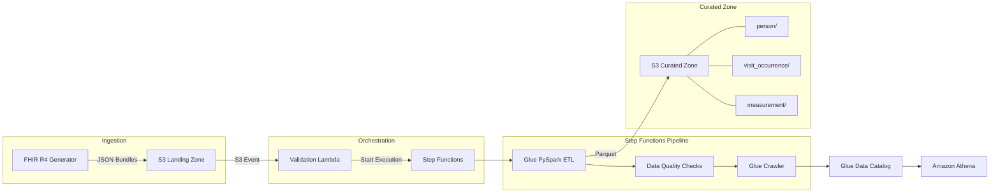

# VitalStream: FHIR-to-OMOP Clinical Data Pipeline

A serverless data engineering pipeline that transforms **HL7 FHIR R4** clinical data into the **OMOP Common Data Model v5.4**, enabling standardized analytics across healthcare datasets.

## Architecture



**Pipeline flow:**
1. **Generate** synthetic FHIR R4 Bundles (Patient, Encounter, Observation) and upload to S3
2. **Validate** incoming bundles via Lambda (structural FHIR R4 checks)
3. **Transform** FHIR resources to OMOP CDM tables using PySpark on AWS Glue
4. **Quality check** output tables (null checks, range validation, referential integrity)
5. **Catalog** curated Parquet via Glue Crawler for SQL access through Athena

## What This Demonstrates

| Skill | Implementation |
|-------|---------------|
| **PySpark** | Native DataFrame ops — `explode`, broadcast joins for vocabulary lookup, `StructType` schema enforcement. No UDFs or `toPandas()`. |
| **Healthcare Data Standards** | FHIR R4 resource modeling, LOINC vital sign codes, OMOP CDM v5.4 table mapping with correct concept_ids |
| **Pipeline Orchestration** | Step Functions state machine with error handling, synchronous Glue job execution, crawler integration |
| **Data Quality** | Null checks, clinically plausible range validation, referential integrity between OMOP tables |
| **Infrastructure as Code** | Modular Terraform: S3, Lambda, Glue, Step Functions, IAM — all resources defined, no console clicks |
| **Testing** | PySpark unit tests with local SparkSession, FHIR validation tests, domain-correctness assertions |

## FHIR-to-OMOP Mapping

| FHIR Resource | OMOP Table | Key Mapping |
|--------------|------------|-------------|
| Patient | `person` | gender → `gender_concept_id` (male=8507, female=8532) |
| Encounter | `visit_occurrence` | class AMB → `visit_concept_id` 9202, IMP → 9201 |
| Observation (vital signs) | `measurement` | LOINC code → `measurement_concept_id` via vocabulary lookup |

**Vital signs mapped (LOINC → OMOP):**

| Vital Sign | LOINC Code | OMOP concept_id |
|-----------|------------|-----------------|
| Heart Rate | 8867-4 | 3027018 |
| Systolic BP | 8480-6 | 3004249 |
| Diastolic BP | 8462-4 | 3012888 |
| Body Temperature | 8310-5 | 3020891 |
| Respiratory Rate | 9279-1 | 3024171 |
| O2 Saturation | 2708-6 | 3016502 |

## Quick Start

### Prerequisites
- Python 3.10+
- Java 11+ (for PySpark)

### Install & Test
```bash
pip install -e ".[dev]"
make test
```

### Generate Sample Data
```bash
make generate
# Creates 10 FHIR R4 Bundles in output/fhir_bundles/
```

### Deploy Infrastructure
```bash
cd infrastructure
terraform init
terraform apply
```

### Query with Athena
```sql
-- Vital sign measurements with patient demographics
SELECT p.person_source_value AS mrn,
       p.year_of_birth,
       m.measurement_date,
       m.measurement_concept_id,
       m.value_as_number,
       m.unit_source_value
FROM vitalstream_db.measurement m
JOIN vitalstream_db.person p ON m.person_id = p.person_id
ORDER BY m.measurement_date DESC;
```

## Project Structure

```
src/
  data_generator/       # FHIR R4 synthetic data generation
    fhir_templates.py   # Pure functions building Patient, Encounter, Observation resources
    vocabulary.py       # LOINC → OMOP concept_id mappings
  validation_lambda/    # S3-triggered FHIR validation + Step Functions trigger
  glue_jobs/            # PySpark ETL and data quality
    fhir_parser.py      # Spark: explode FHIR Bundles → typed DataFrames
    omop_mapper.py      # Spark: FHIR DataFrames → OMOP CDM tables
    data_quality.py     # Null, range, and referential integrity checks
  shared/
    omop_schema.py      # PySpark StructType definitions for OMOP v5.4
tests/                  # pytest suite with local SparkSession
infrastructure/         # Terraform: S3, Lambda, Glue, Step Functions, IAM
```

## Tech Stack

- **Python 3.10** / **PySpark 3.4+** — ETL processing
- **AWS Glue** — Managed PySpark execution
- **AWS Step Functions** — Pipeline orchestration
- **AWS Lambda** — Serverless FHIR validation
- **Amazon S3** — Landing zone (raw FHIR) + curated zone (OMOP Parquet)
- **AWS Glue Data Catalog + Amazon Athena** — SQL analytics
- **Terraform** — Infrastructure as Code
- **HL7 FHIR R4** — Source clinical data standard
- **OMOP CDM v5.4** — Target common data model (OHDSI)
