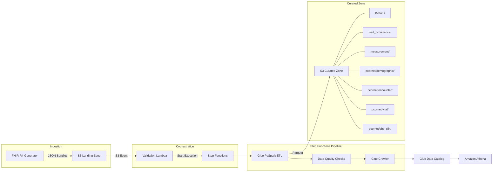

# VitalStream: FHIR-to-OMOP/PCORnet Clinical Data Pipeline

[](https://github.com/MIFUNEKINSKi/vitalstream-clinical-lake/actions/workflows/ci.yml)

A serverless data engineering pipeline that transforms **HL7 FHIR R4** clinical data into two research common data models from a single parse: the **OMOP Common Data Model v5.4** (OHDSI) and the **PCORnet Common Data Model v6.1**. It is a personal portfolio project and runs entirely on synthetic data — no real patient data is involved.

## Architecture



**Pipeline flow:**
1. **Generate** synthetic FHIR R4 Bundles (Patient, Encounter, Observation) and upload to S3
2. **Validate** incoming bundles via Lambda (structural FHIR R4 checks)
3. **Transform** FHIR resources to OMOP CDM and PCORnet CDM tables in one PySpark job on AWS Glue
4. **Quality check** output tables (null checks, range validation, referential integrity; PCORnet value-set conformance and OMOP ↔ PCORnet reconciliation)
5. **Catalog** curated Parquet via Glue Crawler for SQL access through Athena

## What This Demonstrates

| Skill | Implementation |
|-------|---------------|
| **PySpark** | Native DataFrame ops — `explode`, broadcast joins for vocabulary lookup, `StructType` schema enforcement. No UDFs or `toPandas()`. |
| **Healthcare Data Standards** | FHIR R4 resource modeling, LOINC vital sign codes, OMOP CDM v5.4 table mapping with correct concept_ids, PCORnet CDM v6.1 tables with PCORnet value sets and RAW_ source fields |
| **Pipeline Orchestration** | Step Functions state machine (event-driven ingestion) + Airflow DAG scheduling the dbt build and DQ tests, with a CI DAG-integrity check |
| **Data Quality** | Null checks, clinically plausible range validation, referential integrity between OMOP tables; PCORnet required-field, value-set, primary-key and referential checks plus OMOP ↔ PCORnet row reconciliation |
| **Analytics Engineering (dbt)** | `sources → staging → marts` over the OMOP tables with schema tests mirroring the pipeline DQ checks; dbt-duckdb locally/CI, dbt-athena against the deployed stack |
| **Infrastructure as Code** | Modular Terraform: S3, Lambda, Glue, Step Functions, IAM — all resources defined, no console clicks |
| **Testing** | PySpark unit tests with local SparkSession, FHIR validation tests, domain-correctness assertions |

## Design Decisions

- **FHIR to OMOP:** FHIR R4 is the source exchange format, while OMOP CDM provides normalized relational tables for cohorting, quality review, and downstream analytics.
- **One parse, two CDMs:** FHIR bundles are flattened once (`fhir_parser.py`); `omop_mapper.py` and `pcornet_mapper.py` both consume those DataFrames, so the two models cannot disagree about which patients, encounters and observations exist — and a DQ check proves it.
- **No Spark UDFs:** Transformations use native PySpark DataFrame operations so Glue can optimize execution plans and avoid Python serialization overhead.
- **Parquet curated zone:** OMOP outputs are written as Parquet for column pruning, compression, schema preservation, and efficient Athena scans.
- **Step Functions orchestration:** The pipeline uses AWS-native task orchestration instead of cron so validation, Glue ETL, DQ checks, crawler updates, and failure states are explicit.
- **DQ failure behavior:** Validation and Glue task failures halt the state machine; DQ checks emit a structured report with pass/fail counts and check-level violations.
- **Single source of truth for clinical reference data:** `vocabulary.py` defines every vital sign's LOINC/OMOP mapping, plausible range, and alert threshold once; the generator, the DQ checks, and the dbt seed all derive from it.
- **dbt with dual targets:** the same models run on dbt-duckdb over committed sample outputs (free, no AWS, runs in CI) and on dbt-athena against the Glue-cataloged curated zone.
- **Two orchestrators, deliberately:** Step Functions owns event-driven ingestion (S3 upload → validate → ETL → DQ → crawler); Airflow owns the scheduled analytics build (seed → dbt run → dbt test → docs). Each tool where it is strongest.
- **Production hardening:** A production version would add CloudWatch alarms, dead-letter handling, schema drift alerts, PHI controls, secrets management, and partitioned incremental loads.

## FHIR-to-OMOP Mapping

| FHIR Resource | OMOP Table | Key Mapping |
|--------------|------------|-------------|
| Patient | `person` | gender → `gender_concept_id` (male=8507, female=8532) |
| Encounter | `visit_occurrence` | class AMB → `visit_concept_id` 9202, IMP → 9201 |
| Observation (vital signs) | `measurement` | LOINC code → `measurement_concept_id` via vocabulary lookup |

**Vital signs mapped (LOINC → OMOP):**

| Vital Sign | LOINC Code | OMOP concept_id |
|-----------|------------|-----------------|
| Heart Rate | 8867-4 | 3027018 |
| Systolic BP | 8480-6 | 3004249 |
| Diastolic BP | 8462-4 | 3012888 |
| Body Temperature | 8310-5 | 3020891 |
| Respiratory Rate | 9279-1 | 3024171 |
| O2 Saturation | 2708-6 | 3016502 |

## FHIR-to-PCORnet Mapping

The same parsed FHIR DataFrames also produce PCORnet CDM v6.1 tables (the subset of columns the synthetic source can populate):

| FHIR Resource | PCORnet Table | Key Mapping |
|--------------|---------------|-------------|
| Patient | `DEMOGRAPHIC` | `PATID` = FHIR Patient id; gender → `SEX` (male=M, female=F, other=OT, unknown=UN, missing=NI), `RAW_SEX` keeps `male`/`female` as received; `HISPANIC` and `RACE` = NI because the source carries no race/ethnicity |
| Encounter | `ENCOUNTER` | class AMB → `ENC_TYPE` AV, IMP → IP, EMER → ED; `RAW_ENC_TYPE` keeps the FHIR class; `ADMIT_/DISCHARGE_DATE` + `HH:MM` times |
| Observation, BP (8480-6, 8462-4) | `VITAL` | `SYSTOLIC` / `DIASTOLIC` on one wide row per patient + encounter + time, `VITAL_SOURCE` HC, `RAW_SYSTOLIC` / `RAW_DIASTOLIC` |
| Observation, other vitals | `OBS_CLIN` | `OBSCLIN_TYPE` = LC, `OBSCLIN_CODE` = the LOINC code as received, `OBSCLIN_RESULT_NUM` + `OBSCLIN_RESULT_UNIT`, `RAW_OBSCLIN_*` fields |

Not produced: `LAB_RESULT_CM` (the synthetic source has no lab results) and `VITAL.HT` / `WT` / `ORIGINAL_BMI` (no height, weight or BMI observations). The generator draws each vital at an independent time, so most sample `VITAL` rows carry only one BP component; the test fixture covers the paired case (systolic + diastolic taken together → one row).

**How the PCORnet mapping differs from the OMOP one here:**

- **Source codes + code type vs standard concepts.** OMOP maps LOINC 8867-4 to standard `measurement_concept_id` 3027018; PCORnet keeps `OBSCLIN_CODE` = 8867-4 with `OBSCLIN_TYPE` = LC and does no vocabulary mapping.
- **Categorical value sets vs concept ids.** PCORnet uses short codes (`SEX` M/F/UN/OT/NI, `ENC_TYPE` AV/IP/ED/…), with NI (no information) when the source is missing and OT when it is present but unmapped. OMOP uses concept ids, with 0 for unmapped.
- **`RAW_` fields.** Every coded PCORnet column has a `RAW_` partner holding the value exactly as received, so curation can trace any code back to the source.
- **Keys.** PCORnet `PATID` / `ENCOUNTERID` / `OBSCLINID` are the FHIR logical ids; OMOP uses integer surrogate keys.
- **Shape.** Blood pressure is one wide `VITAL` row in PCORnet but two `measurement` rows in OMOP.

**PCORnet data-quality checks** (`pcornet_data_quality.py`, modeled on PCORnet data-curation checks): required fields not null; value-set conformance for `SEX`, `ENC_TYPE` and `OBSCLIN_TYPE`; primary-key uniqueness; referential integrity (every `ENCOUNTER` / `VITAL` / `OBS_CLIN` `PATID` exists in `DEMOGRAPHIC`, every `ENCOUNTERID` in `ENCOUNTER`); and OMOP ↔ PCORnet reconciliation — `person` = `DEMOGRAPHIC`, `visit_occurrence` = `ENCOUNTER`, and `measurement` rows = `OBS_CLIN` rows + populated `VITAL` `SYSTOLIC` / `DIASTOLIC` values.

**Run it:**
- `make test` — mapper, DQ and end-to-end tests for both models (local SparkSession, no AWS).
- `make samples` — runs the same `build_cdm_tables` function the Glue job uses and writes `sample_outputs/pcornet/*.csv` plus `pcornet_data_quality_report.json` next to the OMOP samples.
- Glue: the ETL job writes OMOP to `--target_path` and, when `--pcornet_target_path` is passed (set in `infrastructure/glue.tf`), PCORnet in the same run. Omit it to write OMOP only.

## Quick Start

### Prerequisites
- Python 3.10+
- Java 11+ (for PySpark)

### Install & Test
```bash
pip install -e ".[dev]"
make test
```

### Generate Sample Data
```bash
make generate
# Creates 10 FHIR R4 Bundles in output/fhir_bundles/
```

### Build the dbt Layer
```bash
pip install dbt-duckdb
make dbt-build   # seed from vocabulary.py + staging/marts + tests, no AWS needed
make dbt-docs    # lineage + catalog docs
```
See [`dbt/README.md`](dbt/README.md) for the model layout and the Athena target.

### Deploy Infrastructure
```bash
cd infrastructure
terraform init
terraform apply
```

### Query with Athena
```sql
-- Vital sign measurements with patient demographics
SELECT p.person_source_value AS mrn,
       p.year_of_birth,
       m.measurement_date,
       m.measurement_concept_id,
       m.value_as_number,
       m.unit_source_value
FROM vitalstream_db.measurement m
JOIN vitalstream_db.person p ON m.person_id = p.person_id
ORDER BY m.measurement_date DESC;
```

Additional Athena examples are available in [`analytics/`](analytics/). Small synthetic OMOP and PCORnet outputs are included in [`sample_outputs/`](sample_outputs/) for quick review without deploying AWS infrastructure — they are generated by the actual pipeline code via `make samples`, never edited by hand.

## Project Structure

```
airflow/               # Airflow DAG scheduling the dbt build + DQ tests
analytics/             # Athena SQL examples for clinical analytics and DQ review
dbt/                   # dbt project: staging + marts over OMOP, DQ checks as tests
sample_outputs/        # Synthetic OMOP CSV/JSON examples (generated via make samples)
  pcornet/             # Synthetic PCORnet DEMOGRAPHIC/ENCOUNTER/VITAL/OBS_CLIN + DQ report
scripts/               # Sample-output regeneration + dbt seed generation
src/
  data_generator/       # FHIR R4 synthetic data generation
    fhir_templates.py   # Pure functions building Patient, Encounter, Observation resources
    vocabulary.py       # LOINC → OMOP concept_id mappings, PCORnet value sets
  validation_lambda/    # S3-triggered FHIR validation + Step Functions trigger
  glue_jobs/            # PySpark ETL and data quality
    fhir_parser.py      # Spark: explode FHIR Bundles → typed DataFrames
    fhir_to_omop_etl.py # Glue entry point; build_cdm_tables() parses once, maps to both CDMs
    omop_mapper.py      # Spark: FHIR DataFrames → OMOP CDM tables
    pcornet_mapper.py   # Spark: FHIR DataFrames → PCORnet CDM tables
    data_quality.py     # Null, range, and referential integrity checks
    pcornet_data_quality.py  # PCORnet curation-style checks + OMOP ↔ PCORnet reconciliation
  shared/
    omop_schema.py      # PySpark StructType definitions for OMOP v5.4
    pcornet_schema.py   # PySpark StructType definitions for PCORnet v6.1
tests/                  # pytest suite with local SparkSession
infrastructure/         # Terraform: S3, Lambda, Glue, Step Functions, IAM
```

## Tech Stack

- **Python 3.10** / **PySpark 3.4+** — ETL processing
- **AWS Glue** — Managed PySpark execution
- **AWS Step Functions** — Event-driven pipeline orchestration
- **Apache Airflow** — Scheduled orchestration of the dbt build + DQ tests
- **AWS Lambda** — Serverless FHIR validation
- **Amazon S3** — Landing zone (raw FHIR) + curated zone (OMOP Parquet)
- **AWS Glue Data Catalog + Amazon Athena** — SQL analytics
- **dbt** — Analytics-engineering layer (dbt-duckdb dev/CI, dbt-athena prod)
- **Terraform** — Infrastructure as Code
- **HL7 FHIR R4** — Source clinical data standard
- **OMOP CDM v5.4** — Target common data model (OHDSI)
- **PCORnet CDM v6.1** — Second target common data model (PCORnet)
